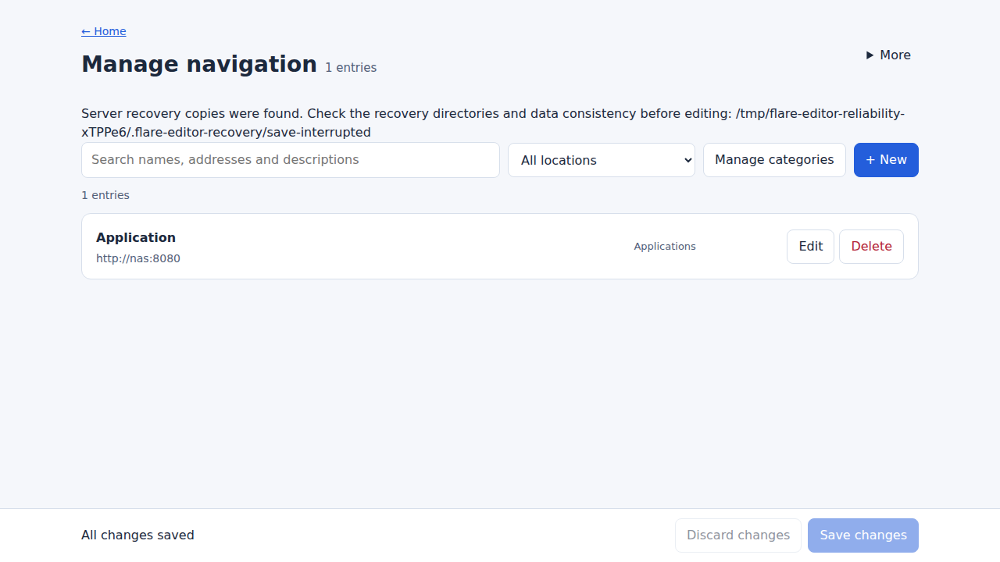

# Development editor screenshots

These are real production-build Chromium captures from the editor acceptance
suite after 0.6.4, using disposable test data. They do not depict the published
0.6.4 editor and do not certify physical Safari/Via behavior.

| View | English | 中文 |
| --- | --- | --- |
| Searchable list | [English list](editor-en-list.png) | [中文列表](editor-zh-list.png) |
| Entry form | [English form](editor-en-form.png) | [中文表单](editor-zh-form.png) |
| Shared batch editor | [English batch](editor-en-batch.png) | [中文批量编辑](editor-zh-batch.png) |

Regenerate with the production binary and the editor browser/reliability suites;
keep the exact tested SHA and viewport in the acceptance evidence. Stored private
user configuration must never be used to produce public screenshots.
